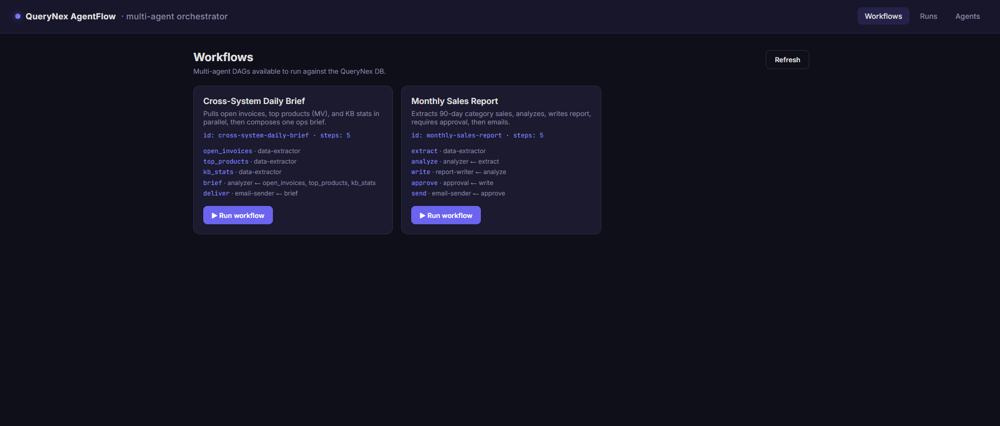
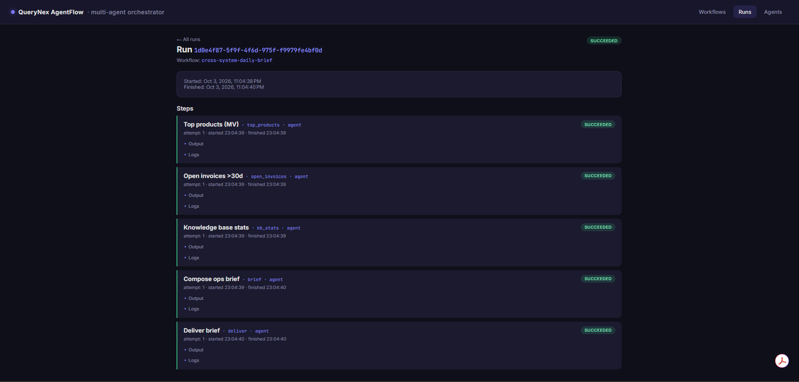
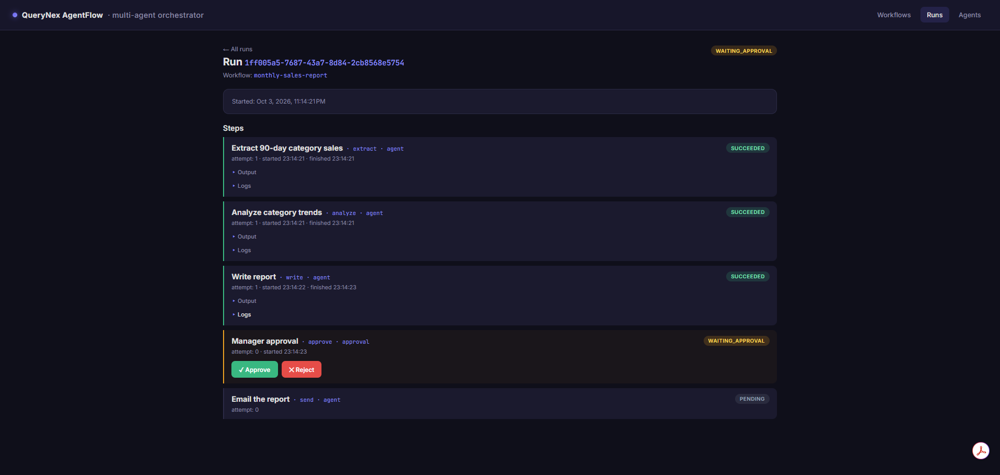
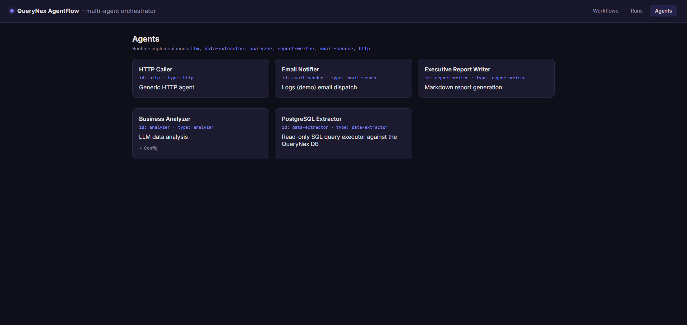

# Multi-Agent Workflow System

> DAG-based orchestration of AI agents for real business processes — parallel execution, retries with backoff, human-in-the-loop approvals, and full audit trail.

[](https://dotnet.microsoft.com)
[](https://angular.io)
[](https://www.postgresql.org)
[](https://groq.com)
[](LICENSE)

Define multi-step business processes as a DAG. Each step is an **agent** — an LLM call, a read-only SQL query, a report writer, an email notifier, or any HTTP endpoint. The engine runs independent steps in parallel waves, retries failures with exponential backoff, and freezes the whole run at approval gates until a human signs off. Every step's input, output, retry count, and log line is persisted for full auditability.

This is a **framework, not a demo**. Two reference workflows ship out of the box — a monthly sales report and a cross-system daily brief that pulls from all four of the other QueryNex portfolio projects in a single DAG.

---

## Screenshots

| Workflows Dashboard | Run Detail — Parallel Wave |
|---------------------|---------------------------|
|  |  |

| Approval Gate | Agents Registry |
|---------------|-----------------|
|  |  |

---

## Features

- **DAG Orchestration** — Steps declare `dependsOn`; the engine computes waves automatically
- **Parallel Wave Execution** — Independent steps run concurrently (bounded by `MaxParallelPerWave`)
- **Retries with Exponential Backoff** — Per-step policy: `{ maxAttempts, baseDelayMs }`
- **Human-in-the-Loop Approvals** — First-class `approval` step type freezes the run until approved/rejected
- **Agent Registry** — Plug in a new agent by writing one class and inserting one row
- **`${stepId.output.field}` Templating** — Inter-step data flow with type preservation
- **Read-Only SQL Guard** — `DataExtractorAgent` rejects anything that isn't a single `SELECT`/`WITH`
- **Shared Run Context** — Every step's output lives in a JSONB blob, queryable with `->>` operators
- **Async Run Queue** — HTTP accepts immediately; a background `Channel<Guid>` worker drives execution
- **Per-Step Timeouts** — Linked cancellation tokens kill runaway steps
- **Conditional Steps** — `"when": "${extract.output.rowCount}"` skips steps that don't apply
- **Live Monitoring** — Auto-refreshing run list, step timeline, per-step logs and outputs
- **Dual-Model Routing** — `gpt-oss-20b` (bulk) for analysis, `gpt-oss-120b` (quality) for reports
- **Secret Management** — API key in `appsettings.Development.json`, gitignored
- **Reuses the Existing DB** — Additive `08_agentflow.sql` against `ai_sql_demo`; no new database

---

## Architecture

```text
+------------------------------------------------------------+
|                    Angular 22 Frontend                     |
|  +--------------+ +-------------+ +---------------------+  |
|  | Workflows    | | Runs List   | | Run Detail          |  |
|  | (DAG preview)| | (auto-poll) | | (steps + approve)   |  |
|  +--------------+ +-------------+ +---------------------+  |
+----------------------------+-------------------------------+
                             |  HTTP (fetch)
                             v
+------------------------------------------------------------+
|                   .NET 10 Web API                          |
|                                                            |
|  +---------------------+  +-----------------------------+   |
|  | WorkflowsController |  | WorkflowEngine              |   |
|  | RunsController      |  |  - DAG wave computation     |   |
|  | AgentsController    |  |  - Bounded parallelism      |   |
|  +---------------------+  |  - Retry + timeout policy   |   |
|                           |  - Approval gates           |   |
|                           +-----------------------------+   |
|                           +-----------------------------+   |
|                           | AgentRegistry               |   |
|                           |  - llm          (Groq)      |   |
|                           |  - data-extractor           |   |
|                           |  - analyzer                 |   |
|                           |  - report-writer            |   |
|                           |  - email-sender             |   |
|                           |  - http                     |   |
|                           +-----------------------------+   |
|                           +-----------------------------+   |
|                           | RunQueue  (Channel<Guid>)   |   |
|                           | RunWorker (BackgroundSvc)   |   |
|                           +-----------------------------+   |
+----------------------------+-------------------------------+
                             |
                             v
+------------------------------------------------------------+
|      PostgreSQL (Neon) — reuses the ai_sql_demo DB         |
|  Existing: customers, orders, products, invoices,          |
|            documents, document_chunks, mv_* views          |
|  New:      agents, workflows, workflow_runs, step_runs     |
+------------------------------------------------------------+
```

**Request Flow:**

1. User picks a workflow in the Angular UI and clicks **Run**
2. `POST /api/workflows/{id}/run` inserts a `workflow_runs` row plus one `step_runs` row per step (all `pending`), then enqueues the run ID
3. `RunWorker` picks up the ID and calls `WorkflowEngine.ExecuteAsync`
4. Engine reads the DAG, computes which steps are *ready* (all `dependsOn` succeeded)
5. Ready steps are dispatched as a wave, bounded by `MaxParallelPerWave` (default 4)
6. Each step resolves its input through `${...}` templating against the shared run context
7. `DataExtractorAgent` queries the DB; LLM agents call Groq; approval steps freeze the run
8. Output is normalized to a JSON object, stored on `step_runs.output`, merged into `workflow_runs.context`
9. On any `waiting_approval`, the run pauses. The UI surfaces **Approve** / **Reject** buttons
10. Approve marks the step `succeeded`, run re-enqueued, engine resumes from where it left off

---

## Tech Stack

| Layer | Technology | Version |
|-------|-----------|---------|
| **Frontend** | Angular (Standalone + Signals + Zoneless) | 22 |
| **Backend** | .NET Core Web API | 10 |
| **Database** | PostgreSQL | 16+ |
| **DB Driver** | Npgsql | 9.0.2 |
| **Micro-ORM** | Dapper | 2.1.35 |
| **AI Provider** | Groq (OpenAI-compatible API) | `gpt-oss-120b` / `gpt-oss-20b` |
| **Queue** | System.Threading.Channels | Built-in |
| **State** | JSONB columns | Native |

> **Note:** The engine has **zero external orchestration dependencies** — no Temporal, no Hangfire, no Quartz. The DAG scheduler, retry policy, and approval mechanism are ~400 lines of C# in `Engine/`. This makes it trivially portable and easy to reason about.

---

## Project Structure

```text
multi-agent-system/
├── WebAPI/
│   └── AgentFlow.Api/
│       ├── Controllers/
│       │   ├── AgentsController.cs
│       │   ├── WorkflowsController.cs
│       │   └── RunsController.cs
│       ├── Models/
│       │   ├── Models.cs
│       │   └── Dtos.cs
│       ├── Data/
│       │   └── Db.cs
│       ├── Agents/
│       │   ├── IAgent.cs
│       │   ├── AgentContext.cs
│       │   ├── AgentRegistry.cs
│       │   ├── LlmAgent.cs
│       │   ├── DataExtractorAgent.cs
│       │   ├── AnalyzerAgent.cs
│       │   ├── ReportWriterAgent.cs
│       │   ├── EmailSenderAgent.cs
│       │   └── HttpAgent.cs
│       ├── Engine/
│       │   ├── WorkflowDefinition.cs
│       │   ├── ExpressionEvaluator.cs
│       │   ├── RetryPolicy.cs
│       │   ├── WorkflowEngine.cs
│       │   └── RunQueue.cs
│       ├── Services/
│       │   ├── GroqService.cs
│       │   └── WorkflowRepository.cs
│       ├── Seeding/
│       │   └── SampleWorkflows.cs
│       ├── Program.cs
│       ├── appsettings.json
│       └── appsettings.Development.json
├── multi-agent-system-ui/
│   └── src/
│       ├── environments/
│       │   ├── environment.ts
│       │   └── environment.development.ts
│       └── app/
│           ├── workflows-list/
│           ├── runs-list/
│           ├── run-detail/
│           ├── agents-list/
│           ├── agent-flow.service.ts
│           ├── models.ts
│           ├── app.ts
│           ├── app.html
│           ├── app.css
│           ├── app.config.ts
│           └── app.routes.ts
├── database/
│   └── 08_agentflow.sql
├── docs/
│   └── screenshots/
├── .gitignore
├── LICENSE
└── README.md
```

---

## Getting Started

### Prerequisites

- [.NET 10 SDK](https://dotnet.microsoft.com/download/dotnet/10.0)
- [Node.js 22.12+](https://nodejs.org)
- [Angular CLI 22+](https://angular.io/cli) (`npm install -g @angular/cli@latest`)
- [PostgreSQL 16+](https://www.postgresql.org/download/) — or a free [Neon](https://neon.tech) account
- [Groq API Key](https://console.groq.com) — free, no credit card

---

### 1. Database Setup

This project **reuses the `ai_sql_demo` database** from the AI SQL Query Generator, Support Agent, Document Processing, and Code Documentation projects. The migration is **purely additive** — no `CREATE DATABASE`, no `DROP`.

```bash
psql "postgresql://...neon.tech/neondb?sslmode=require" -f database/08_agentflow.sql
```

This creates four new tables:

| Table | Purpose |
|-------|---------|
| `agents` | Registered agent records (id, type, JSONB config) |
| `workflows` | DAG definitions (JSONB `definition`) |
| `workflow_runs` | One row per run with shared `context` JSONB |
| `step_runs` | One row per step with input/output/logs/attempts |

No conflicts with existing tables. The cross-system workflow references `invoices`, `mv_top_products`, `documents`, and `document_chunks` — all from the other projects.

---

### 2. Backend Setup

```powershell
cd WebAPI/AgentFlow.Api
dotnet restore
dotnet user-secrets init
```

**Configure secrets:**

```powershell
# Groq API key
dotnet user-secrets set "Groq:ApiKey" "gsk_your_actual_key"

# Database
dotnet user-secrets set "ConnectionStrings:DefaultConnection" `
  "Host=ep-xxx.neon.tech;Port=5432;Database=neondb;Username=neondb_owner;Password=...;SSL Mode=Require;Trust Server Certificate=true"
```

**Verify:**

```powershell
dotnet user-secrets list
```

**Run the API:**

```powershell
dotnet run --launch-profile https
```

API runs at `https://localhost:7051` (check `launchSettings.json` for your actual port).
Swagger UI: `https://localhost:7051/swagger`

**First-run:** the API seeds two sample workflows and five agents automatically. Watch the terminal for `Seeding complete.` If the DB isn't reachable, seeding is skipped with a warning and you can re-run after fixing the connection.

---

### 3. Frontend Setup

```powershell
cd multi-agent-system-ui
npm install
```

**Update the API URL** in `src/environments/environment.development.ts`:

```typescript
export const environment = {
  production: false,
  apiBase: 'https://localhost:7051/api'
};
```

**Trust the dev certificate once** (required for HTTPS):

```powershell
dotnet dev-certs https --trust
```

Then **close every browser window** and reopen before the next step.

**Run the dev server:**

```powershell
npm start
```

Frontend runs at `http://localhost:4200`.

---

### 4. Run Your First Workflow

1. Open `http://localhost:4200`
2. You'll land on **Workflows** — two are seeded: `monthly-sales-report` and `cross-system-daily-brief`
3. Click **Run workflow** on `monthly-sales-report`
4. You're routed to **Run Detail**. Watch the step timeline:
   - `extract` queries `order_items` / `products` / `categories`
   - `analyze` asks Groq to analyze the categories
   - `write` asks Groq to draft a Markdown report
   - `approve` goes to **waiting_approval** — the run freezes
5. Click **Approve**
6. `send` executes; run status flips to **succeeded**

Then try `cross-system-daily-brief` — three extractors run **in parallel** (same wave), then `brief` fans them in. That's the parallel-agent demo.

---

## API Reference

### `GET /api/workflows`

List all registered workflows.

**Response:**

```json
[
  {
    "id": "monthly-sales-report",
    "name": "Monthly Sales Report",
    "description": "Extracts 90-day category sales, analyzes, writes report, requires approval, then emails.",
    "definition": {
      "id": "monthly-sales-report",
      "name": "Monthly Sales Report",
      "steps": [
        { "id": "extract", "name": "Extract 90-day category sales", "agent": "data-extractor", "dependsOn": null },
        { "id": "analyze", "name": "Analyze category trends", "agent": "analyzer", "dependsOn": ["extract"] },
        { "id": "write", "name": "Write report", "agent": "report-writer", "dependsOn": ["analyze"] },
        { "id": "approve", "name": "Manager approval", "type": "approval", "dependsOn": ["write"] },
        { "id": "send", "name": "Email the report", "agent": "email-sender", "dependsOn": ["approve"] }
      ]
    },
    "createdAt": "2026-10-03T14:00:00Z",
    "updatedAt": "2026-10-03T14:00:00Z"
  }
]
```

---

### `POST /api/workflows/{id}/run`

Start a run. Returns immediately with the run ID; execution happens asynchronously in `RunWorker`.

**Request:**

```json
{
  "input": {
    "requestedBy": "dashboard"
  }
}
```

**Response (202 Accepted):**

```json
{
  "runId": "3ea9f41a-abcf-450a-a41d-e814c1094cbf"
}
```

---

### `GET /api/runs`

List the 50 most recent runs.

**Response:**

```json
[
  {
    "id": "3ea9f41a-abcf-450a-a41d-e814c1094cbf",
    "workflowId": "monthly-sales-report",
    "status": "succeeded",
    "input": { "requestedBy": "dashboard" },
    "context": { "extract": { "output": { "rows": [] } } },
    "startedAt": "2026-10-03T23:02:15Z",
    "finishedAt": "2026-10-03T23:02:48Z"
  }
]
```

**Status values:** `queued`, `running`, `waiting_approval`, `succeeded`, `failed`, `cancelled`

---

### `GET /api/runs/{id}`

Full run detail with every step.

**Response:**

```json
{
  "run": {
    "id": "3ea9f41a-abcf-450a-a41d-e814c1094cbf",
    "workflowId": "monthly-sales-report",
    "status": "waiting_approval",
    "startedAt": "2026-10-03T23:02:15Z"
  },
  "steps": [
    {
      "id": "00000000-0000-0000-0000-000000000001",
      "stepId": "extract",
      "name": "Extract 90-day category sales",
      "type": "agent",
      "status": "succeeded",
      "attempt": 1,
      "output": { "rows": [ { "category": "Electronics", "revenue": 1234567.89, "units": 42 } ], "rowCount": 1 },
      "logs": "[23:02:15] SQL: SELECT c.name AS category, ...\n[23:02:15] Returned 1 rows.",
      "startedAt": "2026-10-03T23:02:15Z",
      "finishedAt": "2026-10-03T23:02:16Z"
    },
    {
      "stepId": "approve",
      "name": "Manager approval",
      "type": "approval",
      "status": "waiting_approval",
      "attempt": 0,
      "startedAt": "2026-10-03T23:02:47Z"
    }
  ]
}
```

---

### `POST /api/runs/{runId}/steps/{stepId}/approve`

Approve or reject a step currently in `waiting_approval`. Resumes (or fails) the run.

**Request:**

```json
{
  "approved": true,
  "comment": "Numbers look correct — send it."
}
```

**Response:**

```json
{
  "resumed": true
}
```

**Notes:**
- Approve marks the step `succeeded`, run re-enqueued, engine continues
- Reject marks the step `failed`, run marked `failed`
- Returns `400` if the step isn't in `waiting_approval`

---

### `GET /api/agents`

List registered agents.

**Response:**

```json
[
  {
    "id": "analyzer",
    "name": "Business Analyzer",
    "type": "analyzer",
    "description": "LLM data analysis",
    "config": {
      "system": "You are a senior data analyst. Summarize key trends and outliers. Use 3-5 bullets."
    },
    "createdAt": "2026-10-03T14:00:00Z"
  }
]
```

---

### `GET /api/agents/types`

List which agent **implementations** are compiled into the running API.

**Response:**

```json
{
  "implementations": [
    "analyzer",
    "data-extractor",
    "email-sender",
    "http",
    "llm",
    "report-writer"
  ]
}
```

---

### `POST /api/agents`

Register a new agent (or update an existing one).

**Request:**

```json
{
  "id": "slack",
  "name": "Slack Notifier",
  "type": "http",
  "description": "Posts messages to a Slack webhook",
  "config": {
    "webhook": "https://hooks.slack.com/services/..."
  }
}
```

---

## How the Engine Works

### DAG Execution

The workflow is a directed acyclic graph. The engine executes it one **wave** at a time.

For the linear workflow:

```text
Wave 1:  extract                            (no deps)
Wave 2:  analyze                            (depends on extract)
Wave 3:  write                              (depends on analyze)
Wave 4:  approve                            (depends on write)     <-- freezes
-- user clicks Approve --
Wave 5:  send                               (depends on approve)
```

For the parallel workflow:

```text
Wave 1:  open_invoices  |  top_products  |  kb_stats     (3 parallel)
Wave 2:  brief                                            (fan-in)
Wave 3:  deliver
```

**Bounded parallelism:** a `SemaphoreSlim(_maxParallel)` caps concurrent steps per wave. Default 4 — enough to fan out without overwhelming the Groq rate limit.

### Expression Evaluation

Step inputs can reference prior outputs:

```json
"input": {
  "data":   "${extract.output.rows}",
  "title":  "Sales Report"
}
```

The evaluator walks the JSON context. **Type preservation matters:** if the whole string is exactly one `${...}` token, the raw value is returned (object, array, number, etc.). If it's mixed with text, values are inlined as strings. That's how `"data": "${extract.output.rows}"` passes an array, not a JSON-encoded string.

### Retries

Each step declares its own policy:

```json
"retry": { "maxAttempts": 3, "baseDelayMs": 500 }
```

The engine catches the exception, logs it, waits `500ms`, `1000ms`, `2000ms` (exponential), and only marks the step failed after the last attempt. Every attempt number is persisted.

### Approval Gates

An `approval` step has `"type": "approval"` and no `agent`. The engine marks it `waiting_approval`, sets the run status to `waiting_approval`, and **returns from `ExecuteAsync`**. No threads are held. When the user clicks Approve, `RunsController` marks the step `succeeded`, re-enqueues the run, and `RunWorker` re-invokes `ExecuteAsync` — which sees the completed step and continues from the next wave.

### Safety Guards

| Guard | Where | What It Does |
|-------|-------|--------------|
| Read-only SQL | `DataExtractorAgent` | Rejects anything that isn't `SELECT`/`WITH`; blocks `;`-chained statements |
| Per-step timeout | `WorkflowEngine` | Linked `CancellationTokenSource` kills runaway steps |
| No-progress detection | `WorkflowEngine` | Fails fast if the DAG can't advance (bad deps) |
| Idempotent upserts | `WorkflowRepository` | `ON CONFLICT DO UPDATE` on all writes |
| Structured output | `NormalizeToDictionary` | All agent returns become JSON objects; no primitive leakage |

---

## Database Schema

### New Tables

| Table | Purpose |
|-------|---------|
| `agents` | Registered agent records (id, type, JSONB config) |
| `workflows` | DAG definitions (JSONB `definition`) |
| `workflow_runs` | One row per run with shared `context` JSONB |
| `step_runs` | One row per step, with `input`, `output`, `logs`, `attempt` |

### Key Columns

| Column | Type | Notes |
|--------|------|-------|
| `workflow_runs.context` | `JSONB` | Whole run state — every step's `{ output: {...} }` |
| `step_runs.input` | `JSONB` | Resolved input after `${...}` templating |
| `step_runs.output` | `JSONB` | Agent's returned object |
| `step_runs.logs` | `TEXT` | Timestamped log lines |
| `step_runs.attempt` | `INT` | Retry counter |

### Querying Run State

```sql
-- What did the extract step return?
SELECT output->'rows' FROM step_runs
WHERE run_id = '3ea9f41a-abcf-450a-a41d-e814c1094cbf' AND step_id = 'extract';

-- Which runs are stuck waiting for approval?
SELECT wr.id, wr.workflow_id, sr.step_id, sr.started_at
FROM workflow_runs wr
JOIN step_runs sr ON sr.run_id = wr.id
WHERE wr.status = 'waiting_approval' AND sr.status = 'waiting_approval';

-- Average duration per step type (across all runs)
SELECT step_id,
       AVG(EXTRACT(EPOCH FROM (finished_at - started_at))) AS avg_seconds,
       COUNT(*) AS runs
FROM step_runs
WHERE status = 'succeeded'
GROUP BY step_id
ORDER BY avg_seconds DESC;
```

### Reused Tables

The schema lives in the **same `ai_sql_demo` database** as your other portfolio projects — no conflicts. The cross-system workflow deliberately reads from `invoices` (Project 4), `documents` / `document_chunks` (Project 3), and `mv_top_products` (Project 6), which makes it a genuine cross-project integration demo.

---

## Security

| Protection | Implementation |
|------------|---------------|
| **Read-only SQL** | `DataExtractorAgent` rejects non-`SELECT`; blocks `;` multi-statements |
| **No AI-executed DDL** | LLM steps cannot touch the DB; only `data-extractor` runs queries, and it guards them |
| **Per-step timeouts** | Linked `CancellationTokenSource` bounded by `timeoutSeconds` |
| **Bounded concurrency** | `SemaphoreSlim` caps parallel agents; no fan-out DoS |
| **Secrets** | `appsettings.Development.json` is gitignored; production uses env vars |
| **CORS** | Restricted to `http://localhost:4200` by default |
| **Approval gates** | Destructive steps can be gated behind human sign-off |
| **No prompt injection surface** | Workflows are user-authored; step inputs are templated from trusted context |

---

## Challenges Solved

- **JSONB serialization after `JsonDocument` disposal** — `NormalizeToDictionary` was extracting `JsonElement`s from a disposed `JsonDocument`, throwing `ObjectDisposedException` on the first write. Fixed by `.Clone()`-ing each child before the `using` block ended
- **DAG execution without an external scheduler** — Reimplemented wave computation in ~120 lines: track completed set, find ready steps, dispatch in parallel, repeat. Zero Hangfire/Quartz/Temporal dependencies
- **Parallel waves without deadlocks** — `SemaphoreSlim` released in a `finally` block; worker drains the wave via `Task.WhenAll`. Bounded by `MaxParallelPerWave` so Groq's rate limit isn't nuked
- **Approval gates that don't hold threads** — `ExecuteAsync` returns when it sees a `waiting_approval` step. `RunsController` re-enqueues on approve. No thread sits idle during a human decision
- **Expression type preservation** — A naive string `.Replace` would turn `${extract.output.rows}` into `"[object Object]"`. The evaluator detects single-token templates and returns the raw value
- **Read-only SQL on AI-generated queries** — `DataExtractorAgent` validates the statement starts with `SELECT`/`WITH` and rejects embedded `;` before it ever hits Npgsql
- **Async run queue** — HTTP accepts immediately (`202 Accepted` + run ID). `Channel<Guid>` decouples the request lifecycle from execution, so long-running workflows don't block Kestrel threads
- **Reusing the existing DB across five projects** — Additive migration (`08_agentflow.sql`) with zero name collisions. The `cross-system-daily-brief` workflow intentionally reads from `invoices`, `mv_top_products`, `documents`, and `document_chunks` — a real integration test that spans all of the other portfolio demos
- **Groq rate-limit-aware model routing** — `analyzer` uses `gpt-oss-20b` (bulk, high TPM); `report-writer` uses `gpt-oss-120b` (quality, one call). Configurable per agent
- **HTTPS `status: 0` in the browser** — `net::ERR_CERT_AUTHORITY_INVALID` from untrusted dev certs. Fixed with `dotnet dev-certs https --trust` and documented in the README
- **Zoneless Angular 22 signals** — Every component uses `ChangeDetectionStrategy.OnPush` + `signal()`; no `zone.js` polyfill anywhere
- **Standalone components everywhere** — No `NgModule`. Every component and the service declare their own imports; routes use lazy `loadComponent()`

---

## Deployment

| Component | Recommended Service | Free Tier |
|-----------|--------------------|-----------|
| **Frontend** | Azure Static Web Apps | 500 MB, 100 GB bandwidth |
| **Backend** | Azure App Service (F1) | 1 GB disk, 60 min CPU/day |
| **Database** | Neon | 0.5 GB, auto-suspend |
| **AI** | Groq | Generous free tier (8K TPM) |

**Deployment notes:**

- **CORS** — Add your frontend's production URL to `Cors:AllowedOrigins` (or set `Cors__AllowedOrigins__0` as an App Service env var)
- **App Service env vars** — Set `Groq__ApiKey` and `ConnectionStrings__DefaultConnection`. Use double underscores for nesting
- **Update `environment.ts`** — Point `apiBase` at the production API URL before building the Angular app
- **Background worker** — `RunWorker` runs in the same App Service instance as the API; on F1 that's fine for demo workloads. For production, split into a WebJob or separate instance
- **Postgres connection pooling** — Npgsql pools by default; Neon's `-pooler` endpoint is recommended for serverless

---

## Sample Test Cases

| Target | Expected Behavior |
|--------|-------------------|
| `monthly-sales-report` end-to-end | `extract` -> `analyze` -> `write` -> approve -> `send`; run ends `succeeded` |
| `monthly-sales-report` — reject at approval | Run ends `failed`; `send` never executes |
| `cross-system-daily-brief` | `open_invoices`, `top_products`, `kb_stats` run **in parallel**; `brief` fans in; `deliver` sends |
| Missing Groq key | LLM steps return `[AI disabled]` stub; workflow still completes end-to-end |
| Bad SQL in `data-extractor` | Step fails fast with `Only SELECT/WITH queries are allowed` |
| Step timeout | Simulated slow HTTP call exceeds `timeoutSeconds`; step fails with cancellation |
| Retry policy | Flaky endpoint retried 3x with 500ms/1000ms/2000ms backoff; final attempt logged |
| `when` guard | Step with false condition marked `skipped`; downstream steps still run if their other deps succeeded |
| New agent at runtime | `POST /api/agents` registers `slack-notifier`; workflow references it by id; run succeeds without restart |
| Rerun same workflow | Fresh run ID; both runs visible in **Runs** list with separate histories |

---

## Contributing

Contributions, issues, and feature requests are welcome!

1. Fork the repository
2. Create a feature branch (`git checkout -b feature/amazing-feature`)
3. Commit your changes (`git commit -m 'Add amazing feature'`)
4. Push the branch (`git push origin feature/amazing-feature`)
5. Open a Pull Request

---

## License

This project is licensed under the MIT License — see the [LICENSE](LICENSE) file for details.

---

## Author

**QueryNex**
- Portfolio: [querynexai.github.io](https://querynexai.github.io)
- GitHub: [@querynexai](https://github.com/querynexai)
- Email: querynex.ai@outlook.com

---

## Show Your Support

If this project helped you, please give it a star — it helps others discover it too.

---

## Acknowledgements

- [.NET](https://dotnet.microsoft.com) for the platform and `System.Threading.Channels`
- [Groq](https://groq.com) for fast, free LLM inference
- [Neon](https://neon.tech) for serverless PostgreSQL
- [Dapper](https://github.com/DapperLib/Dapper) for the simplest micro-ORM in .NET
- The open-source .NET, Angular, and PostgreSQL communities

---

## Project Status

| Component | Status |
|-----------|--------|
| DAG engine | Working |
| Parallel wave execution | Working |
| Retry with backoff | Working |
| Approval gates | Working |
| Expression templating | Working |
| Agent registry | Working |
| Read-only SQL guard | Working |
| Per-step timeouts | Working |
| Conditional (`when`) steps | Working |
| Async run queue | Working |
| Live run dashboard | Working |
| Step-level logs & outputs | Working |
| Two sample workflows | Working |
| Cross-project integration workflow | Working |
| Database persistence | Working |
| README + LICENSE | Ready |